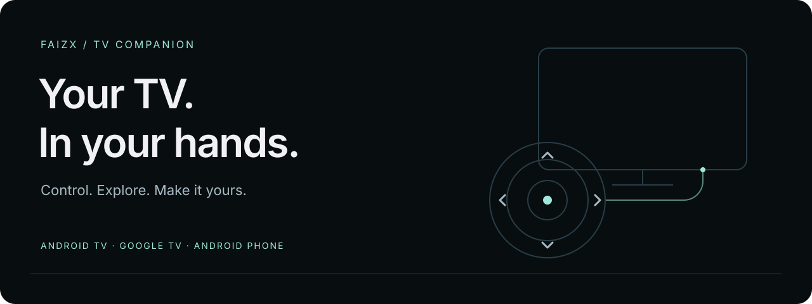
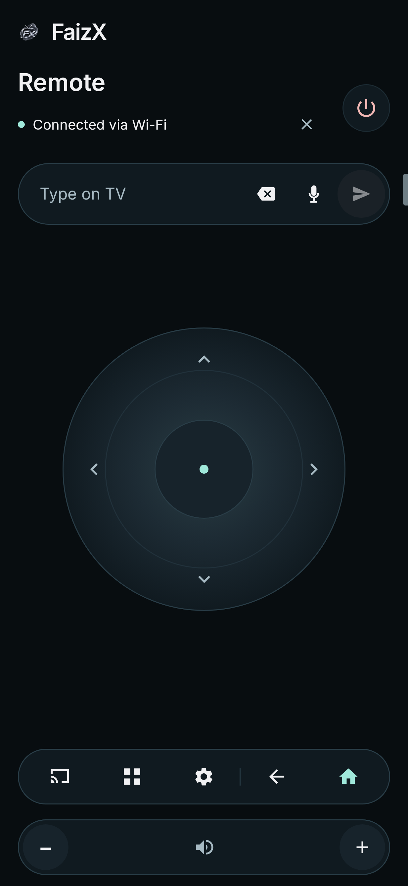
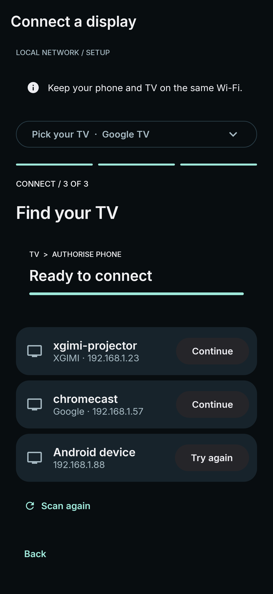
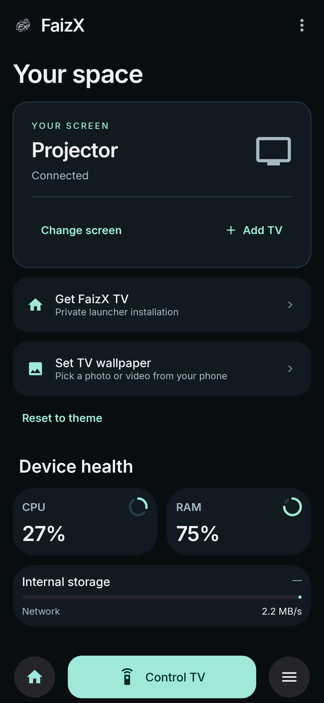
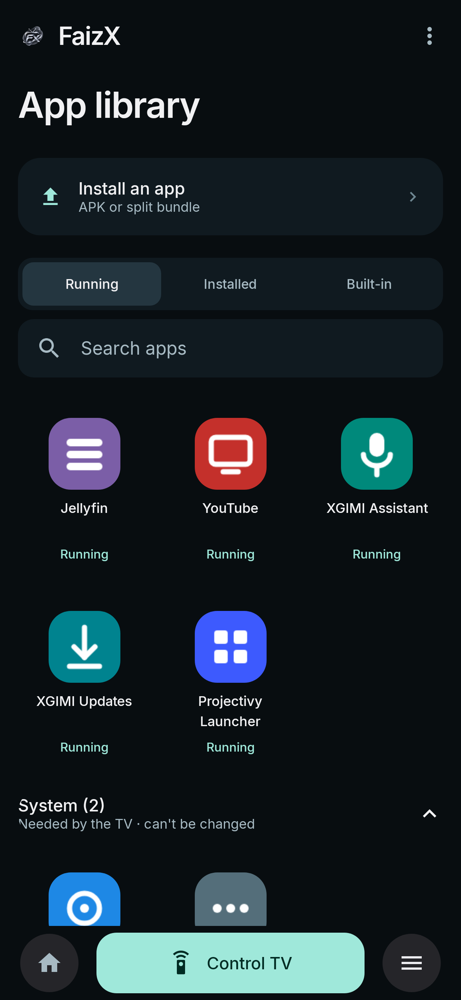
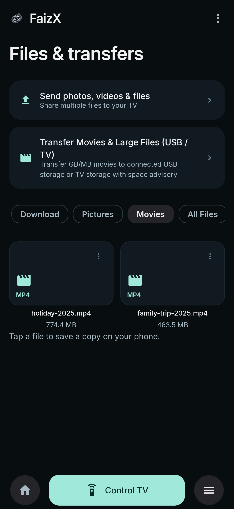
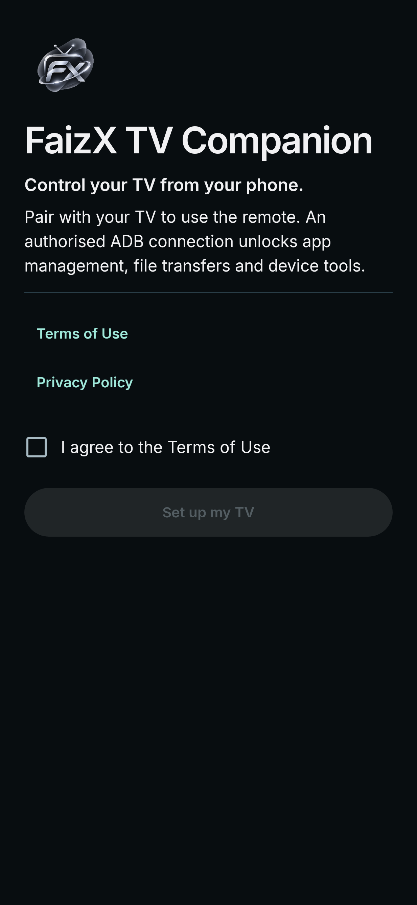
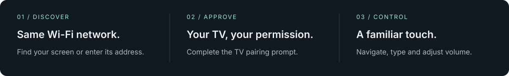

<strong>FAIZX TV COMPANION</strong>

<strong>A thoughtful Android companion for your TV.</strong> Navigate your screen, type from your phone, organise apps and move files in one focused workspace.

<a href="#the-interface">Interface</a> · <a href="#start-with-your-tv">Get started</a> · <a href="docs/features.md">Explore features</a> · <a href="https://github.com/its-faizal/FaizX-TV-Companion-Showcase/releases">Releases</a>

---

## Everyday control, with room to do more

FaizX brings remote control and TV management together without putting every tool in your way. Use the circular pad for navigation, switch to pointer control when your TV supports it, and keep typing, volume and shortcuts within reach.

| Control your screen | Understand your TV | Make it your space |
| :--- | :--- | :--- |
| Circular remote and mouse modes. Keyboard input, voice entry, volume gestures and quick app access. | CPU, memory and storage views, app information and internal or connected storage browsing. | Transfer files, manage apps, set supported FaizX wallpapers and access launcher updates. |

## The interface

<table>
<tr>
<td width="33%" align="center"> <strong>Circular remote</strong></td>
<td width="33%" align="center"> <strong>Connect your TV</strong></td>
<td width="33%" align="center"> <strong>Your space</strong></td>
</tr>
<tr>
<td width="33%" align="center"> <strong>App library</strong></td>
<td width="33%" align="center"> <strong>Files & transfers</strong></td>
<td width="33%" align="center"> <strong>First-run setup</strong></td>
</tr>
</table>

*Interface previews are freshly rendered from the current development source with demonstration data. They illustrate the app; they are not a claim of pairing or compatibility with every TV. Previews show development screens; available builds may differ.*

## Start with your TV

1. **Connect both devices to the same local network.** Open FaizX and select your TV. You can enter an address if discovery does not find it.
2. **Approve the connection on the TV.** Native Wi-Fi remote pairing uses the TV's displayed code. Advanced device-management tools use a separately authorised ADB connection.
3. **Open Control TV.** Use the pad, typing field and volume controls. Open the workspace when you need apps, files or device information.

[Connection guide and troubleshooting →](docs/connecting.md)

## Choose the tools you need

| Feature | What it does | Connection or device requirement |
| :--- | :--- | :--- |
| **Remote & typing** | Directional navigation, select, Back, Home, volume and text entry. | Compatible native Wi-Fi remote service or authorised ADB. |
| **Pointer mode** | Mouse movement, clicks, holds and separate directional rails. | Authorised ADB and a TV firmware input interface that supports it. |
| **Voice & shortcuts** | Dictate text and open TV apps from the phone. Cast opens the phone's system Cast controls. | Microphone permission for voice; compatible phone services and TV connection. |
| **Apps & device tools** | Browse apps, inspect details and use supported maintenance actions. | Authorised ADB; system protections and vendor restrictions still apply. |
| **Files & transfers** | Browse storage and move files between your phone and TV. | Authorised ADB; writable storage and file permissions. |
| **Device health** | View TV-reported CPU, RAM and storage information. | Authorised ADB. Detail and refresh availability depend on the TV. |
| **Capture tools** | Request screenshots or recordings and select an available destination. | TV capture and encoder support. Protected content may not be capturable. |
| **FaizX TV integration** | Manage supported launcher installation, wallpapers and approved updates. | Compatible FaizX TV launcher and authorised update access where required. |

[Full feature guide →](docs/features.md)

## Built around your permission

- **You approve TV access.** Debugging authorisation is separate from normal native remote pairing.
- **A clear separation of roles.** The Companion phone app, TV launcher and update service are separate components.
- **Updates are checked before installation.** Use the intended package and signing identity; Android asks you to confirm installation.
- **Voice is your choice.** Speech recognition uses the service configured on your phone, subject to that service's availability and privacy behaviour.

Read the [Privacy Policy](docs/privacy.md) and [Terms of Use](docs/terms.md) for the app's detailed terms. Never include passwords, pairing codes, private keys or unsanitised device logs in an issue.

## Compatibility

**Phone:** Android 8.0 or newer. **TV:** compatible Android TV or Google TV devices, with features determined by their remote service, firmware and granted permissions. Native remote control does not require TV root. ADB is optional for normal Wi-Fi control and required for the advanced management paths described above.

FaizX does not claim compatibility with every proprietary smart-TV operating system. A feature being visible in the interface does not override restrictions imposed by the TV.

## About this repository

This is the product showcase for FaizX TV Companion. It contains product information, interface previews and user guides. Application source, backend code, build tools, credentials and internal development records are not hosted here.

## Downloads & support

No APK is included in this repository. Signed downloads, when made available here, will be listed under [Releases](https://github.com/its-faizal/FaizX-TV-Companion-Showcase/releases). Do not treat interface previews as a downloadable release.

For help connecting a TV, start with the [connection guide](docs/connecting.md). When reporting a problem, include the app version, TV model and steps to reproduce it. Remove device addresses, pairing codes, personal information and private logs before sharing a report.

## Privacy & terms

Read the [Privacy Policy](docs/privacy.md) and [Terms of Use](docs/terms.md). Software licence acknowledgements are provided with the application. Third-party app names and logos in demonstration screens identify their respective services and do not imply endorsement.
